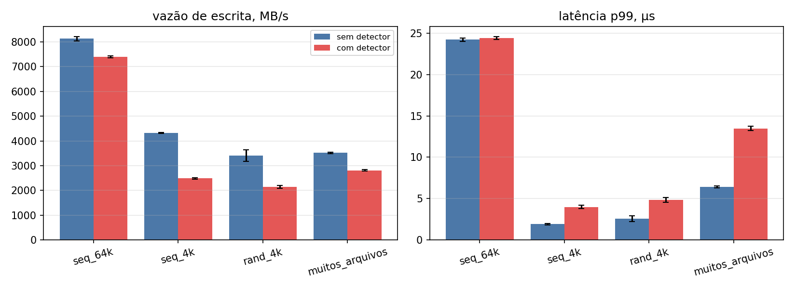
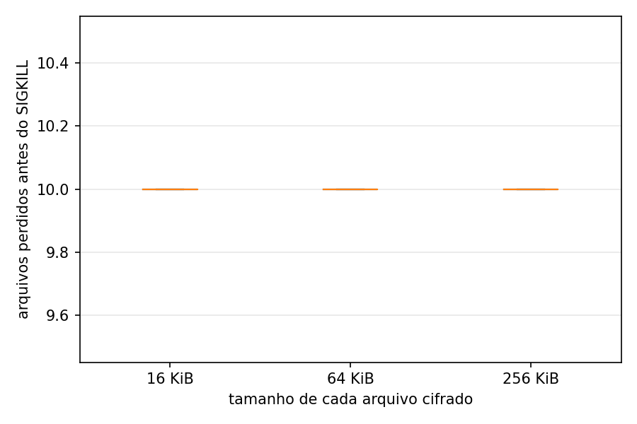

# Resultados do benchmark

## Overhead

Média ± desvio padrão entre repetições. CPU sys é do fio, que é onde o tempo do kprobe aparece, porque o programa eBPF roda no contexto de quem escreve. CPU do agente é o processo em espaço de usuário.

| carga | MB/s sem | MB/s com | perda de vazão | p99 µs sem | p99 µs com | CPU sys % sem | CPU sys % com | ns por kprobe | CPU do agente s | reps |
| --- | --- | --- | --- | --- | --- | --- | --- | --- | --- | --- |
| seq_64k | 8126.9 ± 92.4 | 7393.8 ± 45.0 | +9.0% | 24.2 ± 0.2 | 24.4 ± 0.2 | 89.6 | 89.4 | 1194 | 0.006 | 5 |
| seq_4k | 4324.8 ± 25.5 | 2487.5 ± 31.4 | +42.5% | 1.9 ± 0.1 | 4.0 ± 0.2 | 64.8 | 75.6 | 1023 | 0.008 | 5 |
| rand_4k | 3411.4 ± 227.5 | 2146.4 ± 63.8 | +37.1% | 2.6 ± 0.4 | 4.8 ± 0.3 | 61.8 | 73.6 | 1072 | 0.008 | 5 |
| muitos_arquivos | 3521.2 ± 29.0 | 2811.2 ± 28.1 | +20.2% | 6.4 ± 0.1 | 13.5 ± 0.3 | 75.7 | 78.5 | 1483 | 8.194 | 5 |

## Tempo até o bloqueio

ms até o kill vai do primeiro instante do simulador até o SIGKILL, no mesmo CLOCK_MONOTONIC. Arquivos perdidos são contados no disco depois do kill, inclusive o que ficou truncado pela metade.

| cenário | arquivo KiB | atraso ms | bloqueado | arquivos perdidos | de | ms até o kill | kernel até agente µs |
| --- | --- | --- | --- | --- | --- | --- | --- |
| rapido | 16 | 0 | 5/5 | 10.0 ± 0.0 | 300 | 13.4 ± 0.5 | 51 ± 13 |
| rapido | 64 | 0 | 5/5 | 10.0 ± 0.0 | 300 | 17.6 ± 0.6 | 51 ± 19 |
| rapido | 256 | 0 | 5/5 | 10.0 ± 0.0 | 300 | 31.6 ± 1.1 | 55 ± 15 |
| lento | 64 | 500 | 3/3 | 10.0 ± 0.0 | 40 | 4565.4 ± 26.6 | 96 ± 6 |
| lento | 64 | 1500 | 0/3 | 40.0 ± 0.0 | 40 | - | - |

