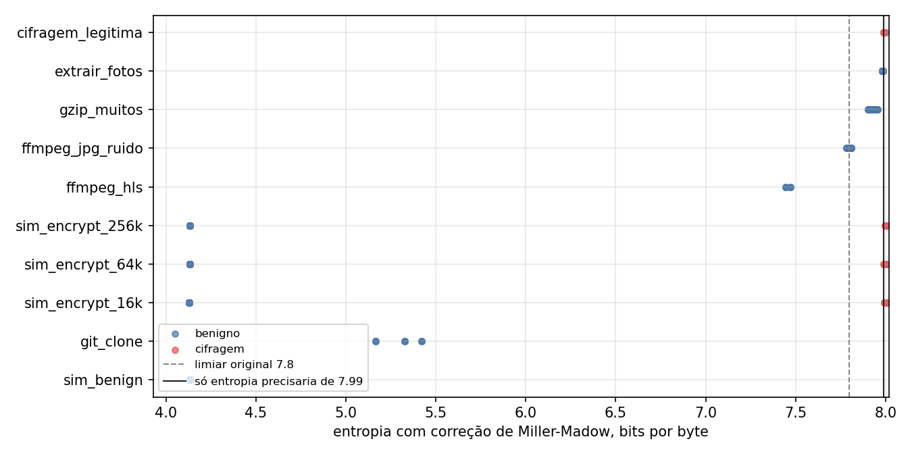
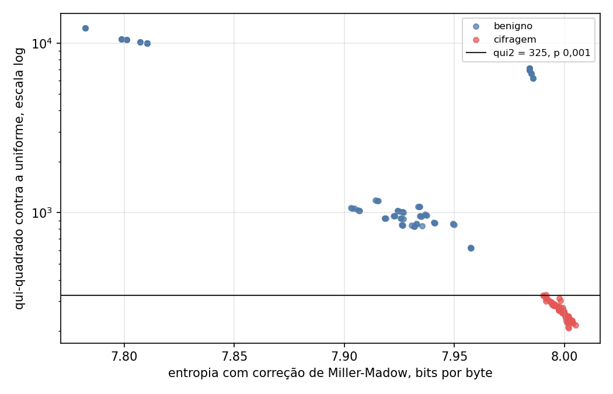

# Calibração do limiar, fp_emulado

39 execuções, 255 eventos, 66 vindos do processo que cifrou.

Taxas por execução. Uma execução benigna conta como alarme falso se qualquer evento dela passa na regra, porque com --kill isso já derruba o processo.

## Regras

| regra | detecção em 7.8 | execuções com falso em 7.8 | limiar recomendado | faixa empatada | detecção | execuções com falso |
| --- | --- | --- | --- | --- | --- | --- |
| entropia comum | 100% | 6/39 | 7.925 | 7.925 a 7.96 | 100% | 3/39 |
| miller-madow | 100% | 9/39 | 7.99 | 7.99 a 7.995 | 100% | 0/39 |
| miller-madow + qui2 | 100% | 0/39 | 7.8 | 7.0 a 7.995 | 100% | 0/39 |

qui2 limite = 325, quantil 0,999 da qui-quadrado com 255 graus de liberdade. Não é ajustado nos dados, vem da teoria.

## Por carga, regra miller-madow + qui2 em 7.8

| carga | classe | eventos | H_mm min | H_mm max | qui2 min | qui2 max | alarme H>=7.8 | alarme recomendado |
| --- | --- | --- | --- | --- | --- | --- | --- | --- |
| gzip_muitos | negativo | 51 | 7.903 | 7.958 | 618 | 1184 | 3/3 | 0/3 |
| tar_gz | negativo | 0 | - | - | - | - | 0/3 | 0/3 |
| zip_r | negativo | 0 | - | - | - | - | 0/3 | 0/3 |
| extrair_fotos | negativo | 18 | 7.984 | 7.986 | 6228 | 7127 | 3/3 | 0/3 |
| ffmpeg_jpg_ruido | negativo | 18 | 7.782 | 7.810 | 9970 | 12260 | 0/3 | 0/3 |
| ffmpeg_hls | negativo | 6 | 7.444 | 7.470 | 102171 | 114764 | 0/3 | 0/3 |
| git_clone | negativo | 9 | 5.164 | 5.420 | 53588 | 118310 | 0/3 | 0/3 |
| sim_benign | negativo | 33 | 4.133 | 4.136 | 1134492 | 1265953 | 0/3 | 0/3 |
| nao_regular | negativo | 0 | - | - | - | - | 0/3 | 0/3 |
| cifragem_legitima | positivo | 12 | 7.990 | 7.999 | 264 | 327 | 3/3 | 3/3 |
| sim_encrypt_16k | positivo | 18 | 7.994 | 8.005 | 216 | 289 | 3/3 | 3/3 |
| sim_encrypt_64k | positivo | 18 | 7.992 | 8.004 | 224 | 309 | 3/3 | 3/3 |
| sim_encrypt_256k | positivo | 18 | 7.998 | 8.002 | 209 | 313 | 3/3 | 3/3 |

Margem pela entropia sozinha, menor máximo de execução positiva menos maior evento negativo, +0.012 bits por byte.

